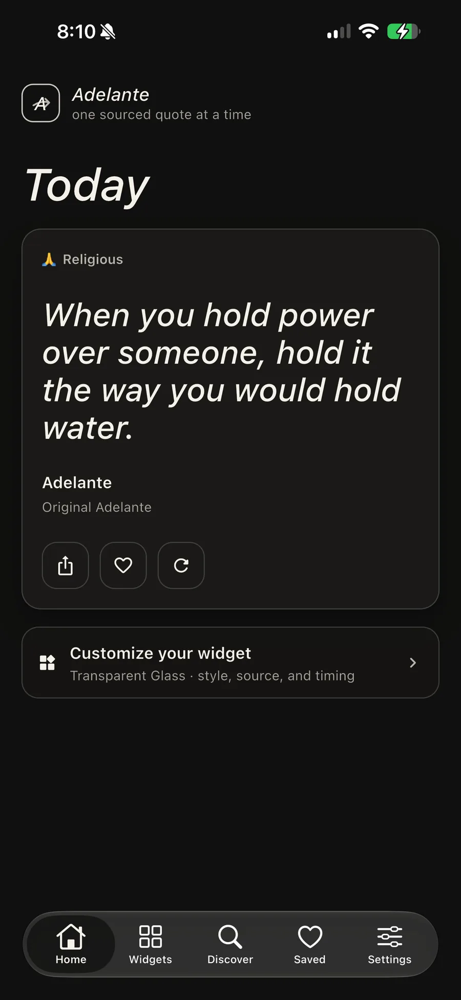
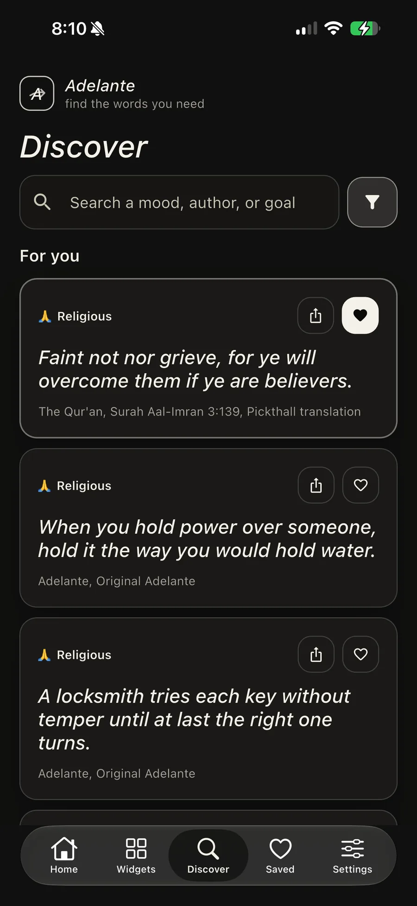
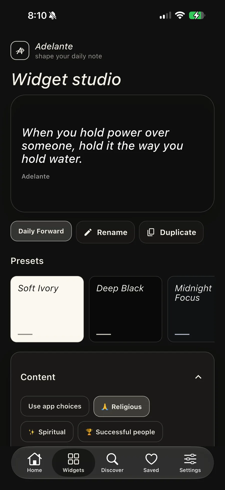

# Adelante

**A little encouragement, right where you’ll see it.**

Adelante is a Flutter motivation app whose main surface is the widget: on the Home Screen, Lock Screen and StandBy. Choose the subjects and sources that matter to you, then shape the typography, colour and layout around your day.

**Available on the App Store since 4 October 2026**, with an Apple Watch app and a Messages extension. Android widgets are implemented, but the Android app is not yet on Google Play. This repository is the public product and engineering showcase; application source is private.

[Get Adelante on the App Store](https://apps.apple.com/us/app/adelante-daily-quotes/id6816598027) · [Read the case study](https://yousofselim.com/work/adelante/) · [Architecture](docs/ARCHITECTURE.md) · [About the developer](https://yousofselim.com)

  
  
  

Actual development captures used in the portfolio case study. [Saved quotations](assets/screens/saved.webp).

## Designed around the widget

- **Native surfaces:** WidgetKit and SwiftUI on iOS, Kotlin and RemoteViews on Android.
- **A widget studio:** preview the layout while choosing fonts, colours, content and refresh timing.
- **Offline content:** keep a local library and a shared widget payload so a widget can render without a live request.
- **Source-aware reading:** attribution travels with quotations into favourites, sharing and widgets.
- **Personal choice:** categories and explicit content preferences shape what appears.
- **Local preferences:** no account is required and there are no ads. Anonymous aggregate usage reporting is optional and off until the reader opts in; it does not measure unique users.

## The engineering problem

A Flutter screen, an iOS extension and an Android widget run in separate environments. They need to agree on the quote and remain useful offline. I built the app, both native widget systems, the shared payload and deterministic content preparation around that constraint.

| Part | Tools |
| :--- | :--- |
| App and widget studio | Flutter / Dart |
| iOS widgets | SwiftUI / WidgetKit |
| Android widgets | Kotlin / RemoteViews |
| Content preparation | TypeScript, Firebase and deterministic filtering |
| Local behaviour | Cached content, shared payloads and source-preserving preferences |

The [case study](https://yousofselim.com/work/adelante/) explains the native integrations, content pipeline, test scope and release status.

## Testing and release evidence

The 12 October 2026 source inventory contains **478 Dart test declarations across 77 files** (363 unit/contract and 115 widget declarations), **105 backend declarations** (68 unit and 37 emulator/operations), and **20 authored Watch XCTest methods** (11 core and 9 UI). Generated build files are excluded. Some Dart tests check native source text; these counts describe the suite, not code coverage or a fresh passing run.

The build 21 delivery note dated 2 October records **566 executed Flutter tests passing**. Parameterised declarations can produce several executed cases, so this is a different measure from the declaration count. GitHub Actions is configured, but no workflow runs were recorded on GitHub when checked on 12 October; the release evidence comes from local checks.

The iOS app is released as version 1.0.0. Android release signing, Play configuration and publication remain pending.

## My contribution

Designed and built by **Yousof Selim**: product design, Flutter app, native widgets, content preparation and verification.

[Explore my other work](https://yousofselim.com/work/) · [Discuss a project](mailto:yousofselim2@gmail.com)
